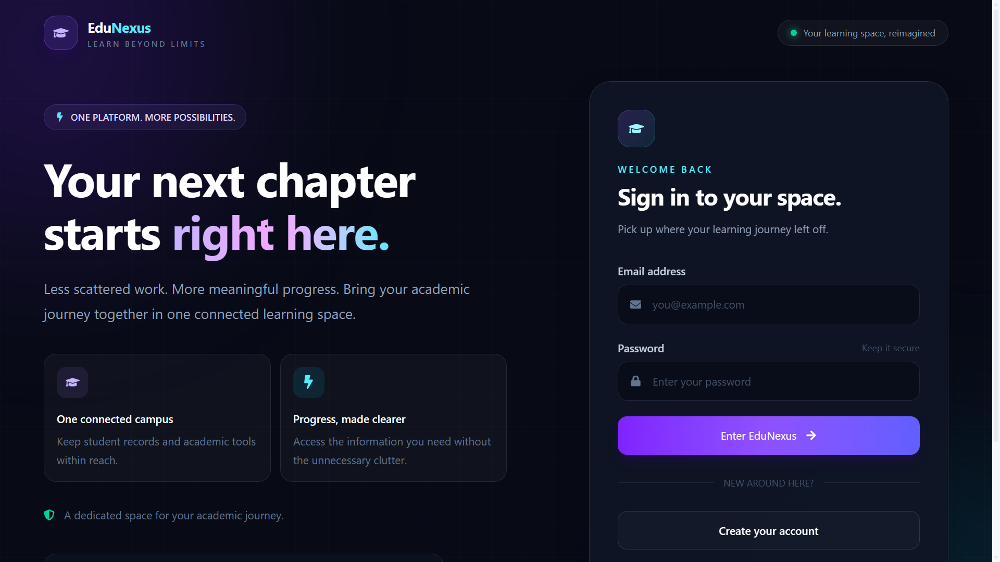

# 🎓 EduNexus — College Management System

<p align="center">
  
</p>

<p align="center">
  <b>One platform. Multiple academic workflows. A better way to manage college operations.</b>
  <br />
  A collaborative full-stack project built to bring essential college management tasks together. 💜
</p>

<p align="center">
  <a href="https://edu-nexus-lilac.vercel.app/">🌐 Live Demo</a> •
  <a href="https://github.com/myselfsneha/EduNexus">💻 Repository</a> •
  <a href="https://edunexus-backend-ps02.onrender.com">⚙️ Backend API</a>
</p>

<p align="center">
  
  
  
  
  
</p>

---

## 💡 About EduNexus

College life comes with plenty of moving parts — student records, attendance, fees, courses, faculty, and timetables.

**EduNexus brings these academic workflows together in one place.**

It is a collaborative full-stack College Management System built with React, Node.js, Express.js, and MySQL, with a focus on practical academic management, role-based access, and a responsive user experience.

## ✨ What's Inside?

<table>
  <tr>
    <td width="50%">
      <h3>🔐 Authentication</h3>
      User registration, login, JWT authentication, protected routes, and role-based access control.
    </td>
    <td width="50%">
      <h3>🎓 Student Management</h3>
      Add, view, update, and delete student records, with dashboard analytics and recent activity.
    </td>
  </tr>
  <tr>
    <td width="50%">
      <h3>📅 Timetable Management</h3>
      Schedule classes by course, subject, faculty, day, time, and classroom, with schedule validation.
    </td>
    <td width="50%">
      <h3>✅ Attendance</h3>
      Mark attendance, view records, and track attendance statistics and progress.
    </td>
  </tr>
  <tr>
    <td width="50%">
      <h3>💳 Fee Management</h3>
      Maintain fee records, track fee status, and view payment information.
    </td>
    <td width="50%">
      <h3>📚 Courses & Faculty</h3>
      Manage course information and faculty-related academic workflows.
    </td>
  </tr>
  <tr>
    <td width="50%">
      <h3>📊 Student Dashboard</h3>
      Student profiles, attendance progress, notifications, and a personal task manager.
    </td>
    <td width="50%">
      <h3>🎨 User Experience</h3>
      Responsive layouts, dark mode, interactive charts, and glassmorphism-inspired UI elements.
    </td>
  </tr>
</table>

## 🛠️ Tech Stack

| Part | Technologies |
|---|---|
| Frontend | React 19, Vite, React Router DOM, Axios |
| Styling | Tailwind CSS, React Icons |
| Backend | Node.js, Express.js |
| Authentication | JWT, bcryptjs |
| Database | MySQL |
| Deployment | Vercel, Render |

## 🖼️ A Peek Inside

*Screenshots coming soon — a little visual tour of EduNexus is on the way!*

| Login & Registration | Student Dashboard |
|---|---|
| *Coming soon* | *Coming soon* |

| Admin Dashboard | Timetable Management |
|---|---|
| *Coming soon* | *Coming soon* |

| Attendance | Fees & Courses |
|---|---|
| *Coming soon* | *Coming soon* |

## 🚀 Run It Locally

### 1. Clone the repository

```bash
git clone https://github.com/myselfsneha/EduNexus.git
cd EduNexus
```

### 2. Set up the backend

```bash
cd backend
npm install
```

Create a local `.env` file with the database configuration and JWT secret required by the backend. Keep credentials private and out of version control.

Start the backend using the script defined in `backend/package.json`.

### 3. Set up the frontend

Open a separate terminal:

```bash
cd frontend/EduNexus
npm install
npm run dev
```

Open the local URL shown by Vite. Ensure the backend and database are configured and running correctly.

## 👥 Meet the Team

Five people, different responsibilities, one collaborative project. 💜

<table>
  <tr>
    <td align="center" width="50%">
      <h3>💻 Sneha Singh</h3>
      <b>Frontend–Backend Integration</b>
      <br />
      Connecting the frontend and backend to bring the different parts of EduNexus together.
    </td>
    <td align="center" width="50%">
      <h3>🎨 Tirthi Jhamar</h3>
      <b>Frontend Development</b>
      <br />
      Working on the user-facing side of the application.
    </td>
  </tr>
  <tr>
    <td align="center" width="50%">
      <h3>⚙️ Shivani Parmar</h3>
      <b>Backend Development</b>
      <br />
      Working on the server-side functionality and backend workflows.
    </td>
    <td align="center" width="50%">
      <h3>🧪 Oshi Kanungo</h3>
      <b>Q&A, Testing & Presentation</b>
      <br />
      Contributing to testing, questions and answers, and project presentation.
    </td>
  </tr>
  <tr>
    <td align="center" width="50%">
      <h3>🧪 Khushi Rathod</h3>
      <b>Q&A, Testing & Presentation</b>
      <br />
      Contributing to testing, questions and answers, and project presentation.
    </td>
    <td align="center" width="50%">
      <h3>🤝 Teamwork</h3>
      <b>Built Together</b>
      <br />
      A collaborative effort from development to testing and presentation.
    </td>
  </tr>
</table>

## 🔗 Project Links

- 🌐 **Live Application:** https://edu-nexus-lilac.vercel.app/
- 💻 **GitHub Repository:** https://github.com/myselfsneha/EduNexus
- ⚙️ **Backend API:** https://edunexus-backend-ps02.onrender.com

## 🌱 What's Next?

Some ideas we'd love to explore:

- 🖼️ Profile picture uploads
- 📩 Email notifications
- 📄 PDF report generation
- 📈 Student performance analytics
- ☁️ Cloud file storage
- ⚡ Real-time dashboard updates

## 📄 License

Developed collaboratively for educational and learning purposes.

---

<p align="center">
  Made with 💜, code, and collaboration.
</p>
